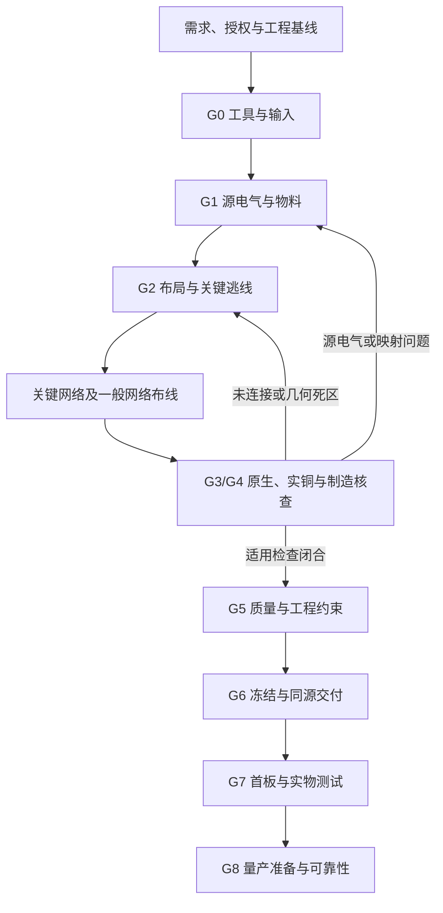

# PCB-Layout

**面向 AI 工程助手的 PCB 自主布局、修复、审查与交付技能。**

`pcb-layout` 将需求、原理图、器件资料和制造约束组织为可执行的工程流程，指导助手完成原生工程操作、布局布线迭代、逐引脚与实际铜连接核查，并按证据给出当前交付阶段。

当前版本：**v2026.10.14.1** · 独立单文件版：自主布局布线与分级验收

[技能正文](SKILL.md) · [版本记录](CHANGELOG.md) · [文件校验清单](SHA256SUMS)

本仓库的执行入口是一个独立的 `SKILL.md`。它定义工作方法、检查要求和验收合同；EDA 软件、自动布线器、几何检查程序及实板测试能力由使用环境提供。安装技能本身不会安装这些工具，也不代表任何 PCB 已通过生产验证。

## 项目信息

| 项目 | 内容 |
| --- | --- |
| 仓库 | [wenqiiizwq-creator/PCB-Layout](https://github.com/wenqiiizwq-creator/PCB-Layout) |
| 技能标识 | `pcb-layout` |
| 技能版本 | `2026.10.14.1`，以 `SKILL.md` 的 `metadata.version` 为准 |
| Git 版本标签 | `v2026.10.14.1` |
| 形态 | 独立、以指令为主体的单文件 Agent Skill |
| 使用对象 | 能读取工程资料、操作 EDA 工具并保存验证证据的 AI 工程助手 |
| EDA 范围 | 面向 KiCad 等 EDA；实际可执行范围取决于工具接口和经过核验的读写能力 |
| 技能来源标识 | `pcb-revision-release 2026.10.13.3`，保留原文件的 `derived_from` 元数据 |

## 适用场景

| 场景 | 技能要求的工作 | 任务边界 |
| --- | --- | --- |
| 从需求或原理图新建 PCB | 明确需求与机械条件，形成经核验的原理图/网表输入，再进入布局、逃线和布线 | 只有需求时，不能把视觉示意直接当作可路由工程 |
| 自主布局布线 | 先验证高密器件扇出与关键回路，再路由一般网络；对剩余未连接继续定位、修复和复验 | 路由器结束或飞线数量减少不等于设计完成 |
| 已有板改版与修复 | 保存基线，在副本中处理漏连、孤立焊盘、约束冲突、布局与回流问题 | 只在授权范围内修改，保留有效设计与历史证据 |
| 只审查 | 检查源电气、PinOut、原生一致性、实际铜、制造文件与适用工程约束 | 不修改生产原件；问题须有定位、证据和闭环条件 |
| PCB 相关替料 | 核完整 MPN、物理引脚、封装、电气行为及 BOM/CPL/固件影响 | 单个器件问题不自动扩大为整板重设计 |
| 制造交付与生产前准备 | 从冻结源导出制造和装配文件，核同源性、工艺、坐标及首板计划 | 工程样板、实板通过和量产就绪分别判定 |

## 核心方法

- **先核源电路，再优化铜实现。** BOM、符号和 PCB 相互一致只能说明同步；器件身份、脚行为和额定条件还需要原厂资料与实际拓扑支持。
- **先证明布局可布通。** 对高密器件逐物理焊盘验证扇出，优先实现电源高 di/dt 回路、去耦、反馈、晶振、差分和接口保护等关键路径。
- **按实体检查连接。** 同网名、同焊盘编号、同铺铜区域标识均不能直接证明实际连接；重复编号副焊盘、EP 和热孔也要覆盖。
- **同时核去程、回流与制造结果。** 保存后的原生铜、Gerber、钻孔、阻焊、锡膏和装配坐标分别回读，记录支持范围与未覆盖对象。
- **按变更传播复验。** 改铜、叠层、封装、MPN、装配变体或规则后，识别受影响检查；确实未变化且仍适用的证据可受控继承。
- **用证据限定结论。** 记录当前源、规则、工具、对象集合、判据及原始结果；空集合、超时、旧报告和未支持对象都不能签为通过。

## 安装与使用

### 使用前准备

| 条件 | 用途 |
| --- | --- |
| 支持加载 `SKILL.md` 的助手 | 阅读并执行技能中的流程与验收要求 |
| 可用的 EDA 环境 | 原生工程读取、编辑、保存、独立重开、规则检查与制造导出 |
| 按任务配置的工具接口 | CLI、Python API、MCP/IPC 或 GUI；先验证实际后端、单位、网络身份和保存语义 |
| 工程输入与器件资料 | 原理图/网表、PCB、库、BOM、规则、需求、datasheet、结构及装配信息 |
| 按风险选择的验证能力 | 铜几何与制造回读、必要的 SI/PI/热分析，以及对应阶段的真实测试 |

没有统一的 Python 依赖安装步骤：本版本未附带脚本包或 EDA 后端。工具不可用时，应记录具体缺口与未完成状态，并推进不依赖该工具的工作。

### 在 Codex 中安装

Codex 的本地技能目录包括用户级 `~/.agents/skills/` 和工程级 `.agents/skills/`。以下采用用户级安装；如果当前环境已经配置了其他可识别的目录，应沿用实际配置并避免同名技能重复安装。目录与加载说明见 [OpenAI 官方 Build skills 文档](https://learn.chatgpt.com/docs/build-skills)。

macOS / Linux 首次安装示例：

```sh
git clone --branch v2026.10.14.1 --depth 1 https://github.com/wenqiiizwq-creator/PCB-Layout.git
cd PCB-Layout

# 仅在目标技能目录尚不存在时安装；已存在则中止，先备份再更新。
(
  set -eu
  mkdir -p "$HOME/.agents/skills"
  mkdir "$HOME/.agents/skills/pcb-layout"
  cp SKILL.md "$HOME/.agents/skills/pcb-layout/SKILL.md"
)
```

Windows 可从指定版本标签下载源码，将 `SKILL.md` 放到 `%USERPROFILE%\.agents\skills\pcb-layout\SKILL.md`；更新已有安装前先保存旧版本。工程级安装则放到目标工程的 `.agents/skills/pcb-layout/SKILL.md`。

最终目录只需包含：

```text
pcb-layout/
└── SKILL.md
```

检查助手可用技能列表中的 `pcb-layout`，并核对文件中的版本字段。若未出现，可重启 Codex 后重试。Codex CLI / IDE 可用 `$pcb-layout` 显式调用，也可以在任务中明确写“请使用 pcb-layout 技能”；相关加载与调用方式见 [官方说明](https://learn.chatgpt.com/docs/build-skills)。

### 在其他助手中使用

将整个 `pcb-layout` 目录放到该助手支持的技能目录，或将 `SKILL.md` 作为明确的任务工作规范提供给助手。该文件不依赖历史对话或其他技能，但各助手的自动发现、工具权限和 EDA 操作能力需要分别确认。

## 任务输入与调用示例

启动任务时，优先提供以下资料中与当前目标相关的部分。无需为了完整形式提供与任务无关的材料；关键参数缺失时，应明确保留为待确认。

| 输入 | 需要说明的内容 |
| --- | --- |
| 任务类型与授权 | 新建、改版、只审查、替料或资料整理；允许修改的范围、必须保留的结构和接口 |
| 工程基线 | 全部层次原理图、PCB、项目规则、符号/封装库、BOM 与装配变体 |
| 功能与电气 | 输入范围、持续/峰值负载、供电组合、接口电平、时序及环境条件 |
| 结构与制造 | 板框、孔、禁布、接口朝向、板厚、叠层、铜厚、工厂能力与特殊工艺 |
| 交付与验收 | 需要的原生/制造/装配文件、目标阶段、判据及可用测试条件 |

**新建工程与自主布局布线**

```text
请使用 pcb-layout 技能，根据所附完整原理图、BOM 和结构约束新建 PCB。
在工程副本中工作，保留已确认的板框、安装孔和接口位置。
先核源电气与实际封装，再完成关键器件扇出、布局和布线。
对原生未连接继续定位、修复和复验，交付可编辑工程及当前证据支持的阶段结论。
决定电气额定或制造能力的缺失参数，请列出并继续其他独立工作。
```

**已有板漏连与布局问题修复**

```text
请使用 pcb-layout 技能，在所附工程的副本中修复未连接和孤立电气焊盘。
保留外形、安装孔和固定接口，区分源映射问题、扇出死区和实际铜断点。
修复后重新铺铜、保存、重开，核对针网、实际铜与制造导出的一致性。
给出每项改动、原始问题定位和对应复验结果。
```

**只审查**

```text
请使用 pcb-layout 技能，对这版 PCB 做生产前审查，不修改生产原件。
检查完整 MPN/PinOut、原生一致性、实体焊盘与实铜连接、回流和制造文件。
按 error / warning / suggestion 列问题，区分确认缺陷、风险假设和证据缺失。
分别给出当前阶段、放行决定及尚需闭合的条件。
```

**替料影响分析**

```text
请使用 pcb-layout 技能，核对所列原器件和候选器件能否同板替换。
比较完整 MPN、物理脚号、封装、电气范围、默认状态及保护行为，
说明对铜、BOM/CPL、固件和测试的影响。先交付可审阅的替换结论与改动清单。
```

## G0–G8 工作流程

各阶段按任务和风险裁剪；不适用项需要理由，缺失证据需要保留状态。详细检查条款以 [SKILL.md](SKILL.md) 为准。

| 阶段 | 检查重点 | 关键证据或产物 |
| --- | --- | --- |
| G0 | 工具、可追溯输入与规则 | 工程/装配身份、源与规则哈希、工具版本、导入差集、约束转换与缺口 |
| G1 | 源电气、物料、物理引脚与封装 | 完整 MPN/原厂资料、PinOut 映射、供电状态和接口行为、载流及额定条件 |
| G2 | 机械约束、布局与关键逃线 | 硬约束、逐焊盘扇出可行性、关键回路、布局检查点 |
| 布线迭代 | 关键网络与一般网络闭合 | 每轮输入/约束、原生剩余端点、失败分类、修复与重新回读 |
| G3 | 原生一致性与对象覆盖 | 全层次网表、实体 pad 集合、双向差集、适用 ERC/DRC、规则与例外 |
| G4 | 实际铜与制造回读 | 按几何接触建立的连接关系、Gerber/钻孔/Mask/Paste 核查及未支持对象 |
| G5 | 布局质量、SI/PI、热与机械 | 去程/回流、时序/阻抗、完整电源路径、热边界与真实装配空间 |
| G6 | 制造、贴片与同源交付 | 冻结源、制造包、BOM/CPL/装配一致性、工艺和坐标合同 |
| G7 | 首板、烧录与实物验证 | 可执行计划、样本与版本、仪器/条件/限值、真实读数和未测范围 |
| G8 | 量产准备与适用可靠性 | 批次物料、工艺/烧录/治具、过程与成品测试、追溯及可靠性闭环 |



上述流程图便于阅读，实际执行可在任何阶段根据新证据回到受影响的步骤；流程走完也必须核实相应证据才能给出阶段结论。

## 检查状态、问题等级与交付阶段

这三组信息分别记录，不能互相替代。

### 单项检查状态

| 状态 | 含义 |
| --- | --- |
| `PASS` | 当前基线、覆盖范围和原始结果支持满足判据 |
| `FAIL` | 检查结果不满足已定义的判据 |
| `INSUFFICIENT` | 缺输入、缺能力、未覆盖、解析失败或证据不足 |
| `NA` | 有明确理由证明本项不适用 |

问题另记 `error / warning / suggestion`、确认缺陷或风险假设、放行影响和闭环条件。`warning` 可能阻止放行；发现 `error` 也需要区分真实电气问题与库建模问题。

### 工程交付阶段

| 阶段 | 可以表达的结论 |
| --- | --- |
| `INCOMPLETE_NOT_RELEASED` | 有未连接、未分类对象、未闭合问题或缺失证据，供继续设计与审查 |
| `CAD_VERIFIED` | 保存重开、适用原生检查、完整针网映射与实铜/制造回读在声明范围内通过 |
| `PROTOTYPE_READY` | G0–G6 的适用项闭合，特殊工艺及偏差有依据，同源制造包和首板计划齐全，可按明确条件制作工程样板 |
| `PROTOTYPE_VERIFIED` | 另有 G7 的真实样本和工况测试证据，仅覆盖已测试范围 |
| `PRODUCTION_READY` | 再完成 G8 的物料、工艺、烧录、测试及适用可靠性闭环 |

阶段与放行决定必须同时给出，例如 **`CAD_VERIFIED + HOLD`**。CAD 检查通过、工厂接受工艺和实物合格是不同的事实。

## 运行任务时的交付物

下列是执行 PCB 任务时按范围产生的交付物，**本技能仓库不附带某个具体电路板工程或制造包**。

| 交付物 | 内容要求 |
| --- | --- |
| 原生工程 | 可编辑、可重开；包含相关层次、局部库、规则及装配配置 |
| 简洁证据台账 | 串联需求、实现、对象集合、检查方法/判据、原始证据和当前状态 |
| 问题与变更记录 | 具体位号/引脚/网络/层/UUID、影响、修复动作和复验条件 |
| 制造与贴装数据 | 适用 Gerber、PTH/NPTH/槽孔、BOM、CPL、装配图及所需模型，绑定同一冻结源 |
| 测试计划与实测记录 | 烧录/恢复、探点、步骤、限值；实测记录标明样本、仪器、工况和硬件/固件版本 |
| 收尾结论 | 当前有效文件入口、完成范围、未决问题、准确阶段和放行决定 |

证据台账至少要能回答：检查的是哪版源和哪些对象、用什么方法与判据、原始结果在哪里、有哪些例外或未支持项、改动后如何复验。无需为了格式制造多份重复报告。

## 能力边界与本版案例

- 技能规定助手应执行的工程动作；本仓库没有内置自动布线器、通用实铜分析器、EDA MCP 服务或通用电气判断程序。
- KiCad 命令示例写在技能正文中，正文标注的核实版本为 `10.0.4`。使用者应按自己的实际版本检查 `--help`、API 与输出格式；本仓库发布不等同于跨版本兼容性测试。
- 原生 DRC/ERC、网名正确、文件同步或路由完成均不足以单独证明电气正确、实体全连接或生产就绪。
- 工具对特殊焊盘、net-tie、盲埋孔、多层非镀通形状等支持不足时，要逐项披露覆盖缺口，不能由空报告推出通过。
- 没有模型或实测数据时，不编造 SI/PI、EMC、热或可靠性结论；简单低风险任务也不机械要求无关的全套仿真。

`SKILL.md` 第 12 节保留了来源案例的回归边界：初次自主 layout 候选存在 48 项原生未连接，R3 复用原布局后的实体连接证据通过，后续审查仍发现阻止放行的源电气/物料问题。这些是技能正文记录的历史案例，相关工程和原始测试资料未随本仓库发布，也未在本次发布时重跑。

因此，这个版本不能被描述为“已证明全自动 layout 可生产”。案例中的型号、孔数、电流、层数和具体工艺也不是新工程默认参数。

## 仓库结构、版本与校验

```text
PCB-Layout/
├── SKILL.md        # 唯一技能执行入口，保留 v2026.10.14.1 正文
├── README.md       # 项目说明、安装、流程与边界
├── CHANGELOG.md    # 本仓库版本记录
├── SHA256SUMS      # 技能与公开说明文件的 SHA-256
├── .gitattributes  # 文本换行约定
└── .gitignore      # 本地临时文件忽略规则
```

`v2026.10.14.1` 对应本次技能版本。`main` 可继续更新，复现本版时应使用版本标签或具体提交。

克隆后，在仓库根目录校验文件内容：

```sh
# macOS
shasum -a 256 -c SHA256SUMS

# Linux（使用 sha256sum 的环境）
sha256sum -c SHA256SUMS
```

校验清单不包含其自身和 `.git/`。哈希一致证明文件内容一致，不证明 PCB 工程通过检查。

后续更新应同步技能版本字段、版本记录和校验清单。提交工程案例时，请将经验提炼为“触发条件 → 检查/修复动作 → 完成证据 → 不能推出的结论”，保留可复核证据并避免将项目参数变成通用默认值。

问题反馈可通过 [GitHub Issues](https://github.com/wenqiiizwq-creator/PCB-Layout/issues) 提交，说明技能版本、EDA/工具版本、最小复现、预期与实际结果，并提供适合公开的证据。

当前仓库尚未指定许可证。
